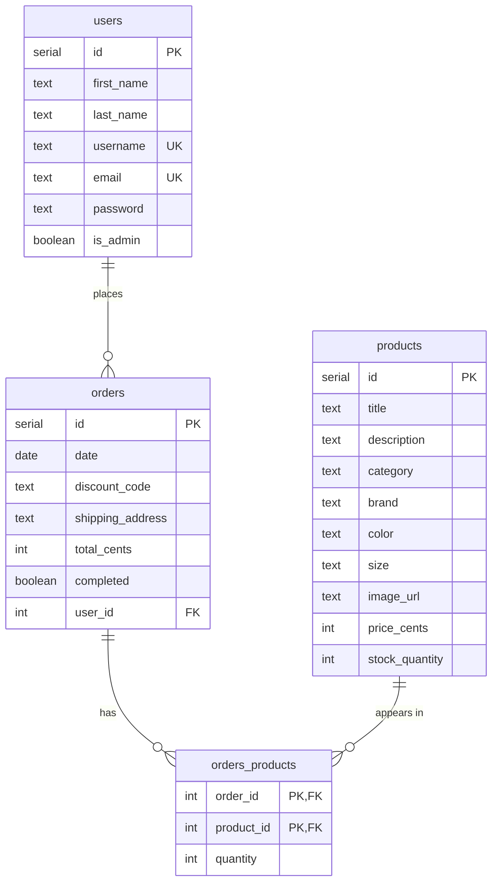

# 🛒 DeckMart

DeckMart is our Capstone backend: a Node/Express server that stores the app's data in PostgreSQL, handles sign-up and login, and gives the frontend API routes to read and save data.

[✏️ Who it's for, in one sentence.]

- 🖥 **Website:** [deckmart.netlify.app](https://deckmart.netlify.app/) (Netlify)
- 🌐 **Backend:** [capstone-backend-api-yzce.onrender.com](https://capstone-backend-api-yzce.onrender.com/) (Render)
- 💡 **Frontend repo:** [capstone-frontend](https://github.com/Lovepreet-Kaur-13/capstone-frontend)

---

## 🎯 Goals

[✏️ The problem, in 1–2 sentences.]

- A REST API for the frontend
- A database for users, products, and orders
- Secure sign-up and login
- Routes only logged-in users or admins can use

This repo is the backend only. The website is in the frontend repo.

---

## 🛠 Tech

- **Server:** Node.js, Express, cors, morgan
- **Database:** PostgreSQL (`pg`)
- **Security:** bcrypt (password hashing), JWT (login tokens), `.env` for secrets
- **Tools:** Git, GitHub, VS Code, Yaak (API testing), DBeaver (database viewer)
- **Hosting:** Render (backend), Netlify (frontend)

---

## ✨ Features

**Shoppers** can create an account, log in, browse products, and view one product. [✏️ Add cart/orders if you have them.]

**Admins** can add, and delete products. Anyone who registers with the `ADMIN_EMAIL` from `.env` becomes an admin.

Passwords are always hashed, and protected routes check for a valid token.

---

## 🗄 Database




| Table             | Stores                                                     |
| ----------------- | ---------------------------------------------------------- |
| `users`           | Accounts (hashed passwords, `is_admin` flag)               |
| `products`        | Items for sale, with price and stock                       |
| `orders`          | Each order: date, address, discount code, total, completed |
| `orders_products` | Links orders to products, with a `quantity` for each       |

- One user has many orders.
- Orders and products are many-to-many, linked by `orders_products`. Its primary key is `order_id` + `product_id`, so a product appears once per order and you change `quantity` instead.
- Money is stored in cents (`1999` = $19.99) to avoid rounding errors.

---

## 🛣 API Routes

Base URL: `http://localhost:3000/api` (or `https://capstone-backend-api-yzce.onrender.com/api` live)
🔒 = logged in · 👑 = admin

| Method | Route             | What it does        | Access |
| ------ | ----------------- | ------------------- | :----: |
| POST   | `/users/register` | Create an account   | Anyone |
| POST   | `/users/login`    | Log in, get a token | Anyone |
| GET    | `/users/me`       | Get your own info   |   🔒   |
| GET    | `/decks`          | Get all decks       | Anyone |
| GET    | `/decks/:id`      | Get one deck        | Anyone |
| POST   | `/decks`          | Add a deck          |   👑   |
| PUT    | `/decks/:id`      | Update a deck       |   👑   |
| DELETE | `/decks/:id`      | Delete a deck       |   👑   |

For 🔒 and 👑 routes, send your token:

```
Authorization: Bearer YOUR_TOKEN_HERE
```

> ⏳ The live server is on Render's free plan, so the first request after a while can take 30–60 seconds.

---

## 🧪 Testing

We tested every route in Yaak, first on localhost, then on the live Render URL.

![Yaak request]

Example `GET /products` response (`200 OK`):

```json
[
  {
    "id": 3,
    "title": "3 of Hearts",
    "description": "Playing card: 3 of Hearts",
    "category": "Hearts",
    "brand": "Standard Deck",
    "color": "red",
    "size": "3",
    "image_url": "https://deckofcardsapi.com/static/img/3H.png",
    "price_cents": 100,
    "stock_quantity": 14
  }
]
```

To view the database in DBeaver: **New Database Connection** → **PostgreSQL** → database `deckmart` → enter your Postgres login → **Finish**.

---

## 💭 What I Learned

[✏️ In your own words: database design, building an API with Express, hashing and JWTs, teamwork with Git.]

## 🔮 Future Improvements

- [ ] Discount codes
- [ ] Payment processing
- [ ] OAuth login

---

## 👥 Team

- **Jesus Cardona Jr** – [GitHub](https://github.com/JDONA21)
- **LovePreet Khela** – [GitHub](https://github.com/Lovepreet-Kaur-13)
- **Andy Hernandez** – [GitHub](https://github.com/FullStackSoftEng101)
- **Ben Elderson** – [GitHub](https://github.com/BenElderson)
